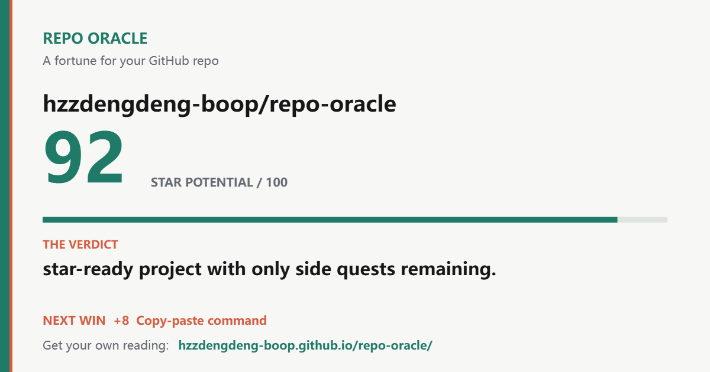

# Repo Oracle

[](https://github.com/hzzdengdeng-boop/repo-oracle/actions/workflows/test.yml)
[](https://hzzdengdeng-boop.github.io/repo-oracle/)
[](LICENSE)

A README roast with receipts. Paste any public GitHub repository and get a
first-impression score, a pointed fortune, and three fixes worth making.
No account, API key, or setup.

**[Read a repo's fortune](https://hzzdengdeng-boop.github.io/repo-oracle/)** |
**[Try a live example](https://hzzdengdeng-boop.github.io/repo-oracle/?repo=neovim%2Fneovim)** |
[See a sample report](examples/sample-report.md)



The score is auditable: every passing or missing signal has a point value, and
the report names the highest-impact next win. Checks cover quickstarts across
common languages and tools, examples, visual proof, license, and GitHub metadata.

**Repo Duel** compares two repositories side by side. Pick your own challenger
or roll a surprise matchup, then share the result. Reports also have permalinks,
downloadable fortune cards, a README badge, and a copy-ready fix checklist.
If GitHub rate limits the API, Repo Oracle labels its narrower README-only
reading and never compares it as though it were a full score.

## Why This Exists

Most README checkers hand you a list of missing headings. Repo Oracle turns
the same first-impression audit into something you might actually share, with
fixes you can make in ten minutes.

## Run It Locally

Serve the folder with any static server:

```bash
python -m http.server 8080
```

Then visit:

```text
http://localhost:8080
```

Run the analyzer checks with `node --test`.

## Contributing

New fortunes, sharper checks, and small UI improvements are welcome. Read the
[contribution guide](CONTRIBUTING.md), then run `node --test` before opening a
pull request.

## What It Checks

- clear one-line positioning
- install and quickstart sections
- usage examples
- screenshots, GIFs, or demo links
- license, topics, stars, issues, and recent updates
- README length and first-screen clarity
- shareable personality and growth advice
- permalinked reports with native device sharing
- downloadable fortune cards

## Project Shape

```text
repo-oracle/
  .github/workflows/test.yml
  CONTRIBUTING.md
  index.html
  robots.txt
  sitemap.xml
  styles.css
  src/
    app.js
    analyzer.js
    examples.js
    fortunes.js
    share-card.js
  examples/
    fortune-card.png
    sample-report.md
```

## Roadmap

- Add CLI mode: `npx repo-oracle owner/repo`
- Add GitHub Action comments for README reviews
- Add AI-assisted deep reviews as an optional mode
- Build a public gallery of memorable repo fortunes

## License

MIT
